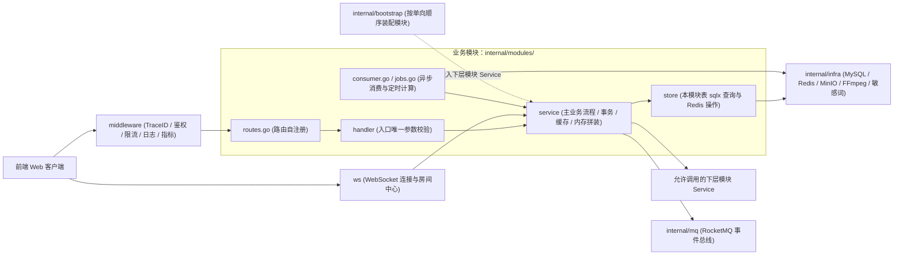
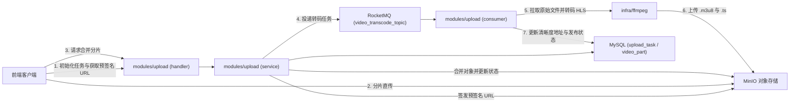

# simple_bilibili 后端架构与目录排布规范

## 1. 进程形态与模块化架构

后端使用单一 Go 模块（`backend/go.mod`），编译为两个独立可执行进程，共享同一套 `internal/` 业务模块与基础设施代码：

- **`cmd/api`**：对外提供 Gin HTTP REST 接口与 WebSocket 长连接服务（实时弹幕房间、在线人数统计、站内未读通知推送）。
- **`cmd/worker`**：运行后台异步任务，包含 RocketMQ 消费者组（FFmpeg 多清晰度 HLS 转码、播放与互动计数回写、用户行为采集与画像更新、站内消息生成、动态写扩散）以及定时计算调度器（全站与标签热度池刷新、ItemCF 视频相似度矩阵计算）。

核心业务代码按领域纵向划分为 8 个高内聚模块，存放在 `backend/internal/modules/` 下。每个模块内部自包含 `handler`、`service`、`store`、`model`、`dto` 与 `routes.go`，有异步消费或定时计算任务的模块在同目录内放置 `consumer.go` 或 `jobs.go`。

### 1.1 模块内部分层与跨模块协作约束

- **模块内单向依赖**：`handler` 只调用本模块 `service`；`service` 负责业务编排、事务协调、缓存防护与跨表数据内存组装；`store` 只操作本模块独占数据表和 Redis Key 前缀，禁止反向依赖 `service`。
- **禁止跨模块直接访问其他模块的 `store`**：每张表与每组 Redis Key 前缀仅归属一个模块。
- **跨模块单向调用**：明确规定每个模块允许直接调用的下层模块 `Service`，绝不出现两个模块互相调用。按数据归属划分接口（如查看某 UP 主投稿视频归属 `video`，查看收藏夹归属 `interaction`，查看关注与粉丝归属 `social`），保持 `user` 模块不依赖其他业务模块。
- **反向联动通过 RocketMQ 异步消费**：评论更新视频计数、视频发布触发动态与推荐入池、互动生成站内通知与行为采集等全部通过 RocketMQ 事件异步消费完成，避免反向代码调用。

## 2. 完整目录排布规范

### 2.1 仓库顶层结构

| 路径 | 职责说明 |
| :--- | :--- |
| `.gitignore` | Git 忽略规则（忽略 `AGENTS.md`、本地密钥配置、构建产物与依赖目录） |
| `docs/` | 业务需求文档与前后端架构文档 |
| `frontend/` | React + TypeScript + Vite 前端工程 |
| `backend/` | Go 后端服务工程 |
| `docker/` | Docker Compose 编排与容器构建配置 |

### 2.2 `backend/` 顶层结构

| 路径 | 职责说明 |
| :--- | :--- |
| `backend/go.mod` | Go 模块依赖定义（`module simple_bilibili/backend`） |
| `backend/cmd/api/main.go` | HTTP 与 WebSocket 服务启动入口，负责配置加载、依赖装配与优雅停机 |
| `backend/cmd/worker/main.go` | 后台消费者与定时计算任务启动入口，负责消费者注册、任务调度与优雅停机 |
| `backend/configs/config.example.yaml` | 完整配置项模板与字段说明 |
| `backend/configs/config.yaml` | 本地运行配置文件（已被 `.gitignore` 忽略） |
| `backend/migrations/` | 按四位序号递增的 MySQL 迁移脚本（`0001_xxx.up.sql`、`0001_xxx.down.sql`） |
| `backend/scripts/` | 种子数据初始化脚本与本地联调辅助脚本 |
| `backend/internal/` | 全部核心业务模块与内部基础设施实现 |

### 2.3 `backend/internal/` 子目录排布

| 目录路径 | 职责说明 |
| :--- | :--- |
| `internal/config/` | 配置结构体定义，使用 Viper 读取 YAML 配置文件并支持环境变量覆盖与启动校验 |
| `internal/bootstrap/` | 装配层，按单向依赖顺序初始化基础设施、各模块 `store`/`service`/`handler`、路由挂载与 Worker 注册 |
| `internal/middleware/` | Gin 全局与路由级中间件（TraceID、结构化日志、异常恢复、CORS、JWT 鉴权、Redis Lua 限流、Prometheus 指标） |
| `internal/ws/` | WebSocket 连接中心、视频弹幕房间连接表、在线人数统计与站内未读通知推送 |
| `internal/mq/` | RocketMQ Topic、Consumer Group 与 Tag 常量、公共消息体定义与生产者封装 |
| `internal/infra/` | 第三方中间件与外部工具客户端封装（`mysql`、`redis`、`minio`、`rocketmq`、`ffmpeg`、`sensitive`、`logger`、`metrics`） |
| `internal/pkg/` | 无业务耦合的通用基础包（`errcode`、`response`、`jwt`、`password`、`snowflake`、`pagination`、`tx`） |
| `internal/modules/` | 8 个按业务领域划分的独立业务模块 |

## 3. 八个业务模块排布清单

| 模块目录 | 负责业务范围 | 独占数据表 | 允许直接调用的模块 | 模块内标准文件 |
| :--- | :--- | :--- | :--- | :--- |
| `internal/modules/user/` | 注册登录、双 Token 续期与注销、个人资料与头像、用户基础信息批量查询、代币余额乐观锁扣减 | `user` | 无 | `routes.go`、`handler.go`、`service.go`、`store.go`、`model.go`、`dto.go` |
| `internal/modules/video/` | 稿件发布与编辑、分 P 播放地址、分区与标签、视频详情缓存、播放与互动计数缓冲回写、`LIKE` 基础搜索、查看某 UP 主投稿列表 | `video`、`video_part`、`video_stat`、`tag`、`video_tag` | `user` | `routes.go`、`handler.go`、`service.go`、`store.go`、`consumer.go`、`model.go`、`dto.go` |
| `internal/modules/upload/` | 文件哈希秒传、MinIO 分片预签名直传、断点续传、分片合并、投递与消费 FFmpeg 多清晰度转码任务 | `upload_task` | `video` | `routes.go`、`handler.go`、`service.go`、`store.go`、`consumer.go`、`model.go`、`dto.go` |
| `internal/modules/danmaku/` | 历史弹幕按时间分段缓存拉取、发送弹幕敏感词过滤与限流、弹幕异步持久化与 WebSocket 房间广播 | `danmaku` | `video` | `routes.go`、`handler.go`、`service.go`、`store.go`、`consumer.go`、`model.go`、`dto.go` |
| `internal/modules/comment/` | 两级楼中楼发表与回复、最热/最新游标分页、热点评论缓存、点赞/点踩、UP 主置顶与点赞标记 | `comment` | `video`、`user` | `routes.go`、`handler.go`、`service.go`、`store.go`、`model.go`、`dto.go` |
| `internal/modules/interaction/` | 点赞、投币事务与 RocketMQ 事务消息、一键三连编排、多收藏夹管理、观看历史缓冲与批量回写 | `video_interaction`、`favorite_folder`、`favorite_item`、`watch_history` | `video`、`user` | `routes.go`、`handler.go`、`service.go`、`store.go`、`consumer.go`、`model.go`、`dto.go` |
| `internal/modules/social/` | 关注与互关判定、粉丝列表、视频与图文动态、混合模式动态流（普通写扩散/大 V 读扩散）、站内通知与未读推送 | `user_follow`、`dynamic_post`、`notification` | `video`、`user` | `routes.go`、`handler.go`、`service.go`、`store.go`、`consumer.go`、`model.go`、`dto.go` |
| `internal/modules/recommend/` | 行为上报与画像更新、热度池与 ItemCF 相似度定时计算、首页三路召回与“换一换”曝光去重打散、相关推荐、全站与分区排行榜 | `user_video_behavior` | `video`、`user` | `routes.go`、`handler.go`、`service.go`、`store.go`、`consumer.go`、`jobs.go`、`model.go`、`dto.go` |

## 4. 各层编码与工程规范

### 4.1 入口校验与内部类型约定
- 所有外部传入数据（Query、Path、JSON Body、Header）只在对应模块的 `handler` 层校验一次；校验通过后将确定类型的值传入 `service` 层，内部函数不再重复执行防御性空值或格式校验。

### 4.2 Service 层主流程与跨表组装规范
- 每个 `service` 公开方法只写清晰的主业务流程，将具体处理步骤放入同文件下方的私有辅助函数，并在主业务方法调用每个私有函数前附上中文注释说明该步骤的业务意图。
- 关联数据组装严格在 `service` 层分步执行：先调用本模块 `store` 获取实体列表，再提取关联 ID 列表调用下层模块 `Service` 的批量查询方法，最后通过 `map[int64]T` 在内存中拼装响应结构体。
- 热点读取方法在 `service` 层统一接入 `singleflight` 合并回源查询，视频详情等接口先经过布隆过滤器校验，缓存过期时间附加随机抖动区间。

### 4.3 Store 层 `sqlx` 与事务规范
- 所有 SQL 语句必须显式声明列名，严禁出现 `SELECT *`，严禁出现 `JOIN` 连表查询与物理外键约束。
- 批量查询统一使用 `sqlx.In` 并调用 `db.Rebind(query)`；调用方传入空 ID 切片时，方法入口直接返回空切片与 `nil`。
- 所有写事务通过 `internal/pkg/tx.WithTx` 执行，将事务句柄注入 `context.Context`；模块 `store` 自动识别事务上下文或普通连接池。
- 同事务跨模块强一致场景（如投币同时扣减用户代币余额与写入互动记录），由发起模块开启 `tx.WithTx` 并将带事务的 `context.Context` 传入下层模块 `Service` 方法。
- 每个模块集中在本模块 `store` 内以函数形式定义该模块独占的 Redis Key 前缀，禁止在业务代码中散写拼接字符串。

### 4.4 统一 HTTP 响应格式与错误码分段规范
- **HTTP 状态码约定**：除 WebSocket 连接握手与协议升级使用 HTTP 状态码表达协议结果外，全部 HTTP 业务接口（包含请求成功、参数错误、鉴权失败、路由不存在、业务失败与服务内部错误）统一返回 HTTP 状态码 `200`。
- **响应体结构约定**：所有 HTTP 接口返回 JSON 固定包含三个字段：`code`、`data`、`msg`（`{"code": 0, "data": ..., "msg": "ok"}`）。前端仅依据 `code` 判断请求成功、参数错误、业务错误或服务端内部错误。
- **错误传递原则**：任意层级发生错误立即携带必要上下文向上返回，在 `handler` 或全局异常恢复中间件中映射为对应业务错误码并统一输出 HTTP `200` 响应。
- `internal/pkg/errcode/code.go` 按模块划分错误码区间：
  - `0`：请求成功
  - `10000 - 10999`：通用系统与协议错误（如 `10001` 参数错误、`10002` 未登录或凭证无效、`10003` 无操作权限、`10004` 资源或接口不存在、`10005` 请求过于频繁、`10500` 服务内部错误）
  - `11000 - 11999`：`user` 模块
  - `20000 - 20999`：`upload` 与 `video` 模块
  - `30000 - 30999`：`danmaku` 与 `comment` 模块
  - `40000 - 40999`：`interaction` 模块（点赞、投币、收藏、观看历史）
  - `50000 - 50999`：`social` 模块（关注、动态、通知）
  - `60000 - 60999`：`recommend` 模块（推荐流、排行榜与搜索）

### 4.5 注释与测试规范
- 代码标识符保持英文原名，注释使用中文，仅针对反直觉的业务约束、并发顺序要求以及 `service` 主函数内调用的小函数添加注释。
- 单元测试文件与源码同目录（`*_test.go`），针对真实 SQL 逻辑、Redis 脚本与核心算法编写测试，不复制业务实现进测试代码。

## 5. 核心跨进程数据链路

### 5.1 视频上传直传与异步转码链路

### 5.2 推荐系统实时采集与在线召回链路

```mermaid
flowchart LR
    Web["前端客户端"]
    RecH["modules/recommend (handler)"]
    RecS["modules/recommend (service)"]
    MQ["RocketMQ (user_behavior_topic)"]
    RecC["modules/recommend (consumer)"]
    RecJ["modules/recommend (jobs)"]
    Redis["Redis (画像 / 相似度 / 热度池 / 已曝光集合)"]
    MySQL["MySQL (user_video_behavior / video / user)"]

    Web -- "上报播放/三连/不感兴趣" --> RecH
    RecH --> RecS
    RecS -- "投递行为事件" --> MQ
    MQ --> RecC
    RecC -- "持久化明细" --> MySQL
    RecC -- "ZINCRBY 更新用户画像" --> Redis
    MySQL -- "定时扫描近 30 天行为" --> RecJ
    RecJ -- "写入热度池与 ItemCF 矩阵" --> Redis
    Web -- "请求首页推荐或相关推荐" --> RecH
    RecS -- "三路召回与去重打散" --> Redis
    RecS -- "调用 video 与 user Service 批量查询视频与 UP 主" --> MySQL
```

## 6. 数据库迁移与本地构建命令规范

### 6.1 `migrations/` 脚本规范
- 每个迁移版本成对提供 `XXXX_description.up.sql` 与 `XXXX_description.down.sql`。
- 已合入主分支的迁移脚本禁止修改，后续表结构演进必须新建更高编号的迁移文件。
- 所有建表语句的每个字段都必须附带 `COMMENT` 业务字段说明，且严禁声明 `FOREIGN KEY` 物理外键约束。

### 6.2 容器启动与常用本地命令

| 命令 | 用途 |
| :--- | :--- |
| `docker compose -f docker/docker-compose.yml up -d` | 启动 MySQL、Redis、MinIO 与 RocketMQ 容器 |
| `go run ./cmd/api -config configs/config.yaml` | 在 `backend/` 下启动 HTTP 与 WebSocket 服务 |
| `go run ./cmd/worker -config configs/config.yaml` | 在 `backend/` 下启动后台消费者与推荐定时计算服务 |
| `go build ./...` | 编译全部后端代码 |
| `go test -race ./...` | 运行全量后端单元测试 |
| `go vet ./...` | 执行 Go 静态检查 |
