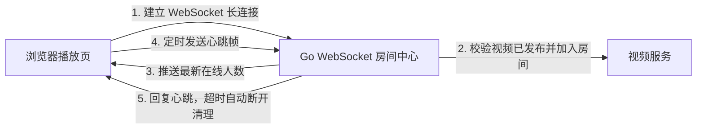
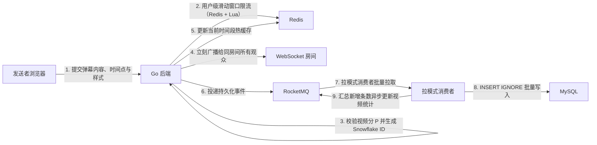

# 实时弹幕与在线人数模块说明

## 进入房间和实时在线人数

不管观众有没有登录，只要打开一个已发布视频的播放页，前端就会和后端建立一条归属该视频房间的 WebSocket 长连接。后端先核对这个视频确实存在且已发布，然后把连接放进对应视频的房间连接池里，并立刻把当前房间在线人数推送给刚进来的观众。

房间里每当有人进来、关掉网页退出，或者断网超过心跳时限被清理，后端就会按节流间隔向房间里的所有在线连接广播最新人数，播放页下方的“XX 人正在看”就会跟着跳动。为了防止某一个网络很差的观众拖慢整个房间，每个连接都有自己独立的发送队列和写协程，队列满了就直接断开这个慢连接。

## 发送弹幕、限流、实时广播与批量持久化

登录用户在播放器底部的弹幕栏输入文字，选好滚动、顶部或者底部模式、字号和颜色，点击发送时前端会带上当前播放位置的毫秒时间点发给后端。

后端入口先校验内容长度、模式、字号、十六进制颜色和时间范围，然后用 Redis 配合 Lua 滑动窗口脚本做用户级限流（比如同一个用户 5 秒最多发 3 条，超限直接提示请求过于频繁），再去视频服务核实这个视频和分 P 是有效的。

校验通过后，后端用 Snowflake 生成全局唯一的弹幕 ID，并立刻做三件事：
- 第一时间通过 WebSocket 房间中心把这条弹幕广播给当前视频房间的所有在线观众。发送者自己的画面会立刻带高亮边框飘出这条弹幕；其他观众如果刚好播到这个时间点附近也会马上看到，还没播到的则先放进前端弹幕池里，播到对应时刻自然飘出。
- 把这条新弹幕写进对应 5 分钟时间段的 Redis 缓存，保证刚发完立刻刷新页面也能直接拉到。
- 把持久化事件投递到 RocketMQ，请求就快速返回给前端。

后台同进程里跑着一个 RocketMQ 拉模式消费者，专门按批次把弹幕事件从队列里拉出来，用一条批量 `INSERT IGNORE` 写入 MySQL（依靠唯一主键保证重复投递也不会多写数据）。整批写完以后，再按视频把这批实际新增的弹幕条数汇总起来，往视频统计同步队列发一条增量消息，由视频模块的消费者把 `video_stat` 里的弹幕总数加上去，并清掉视频详情缓存。

## 历史弹幕分段拉取与前端播放联动

为了避免长视频或者热门视频一进页面就拉几万条弹幕卡住首屏，历史弹幕按视频分 P 和每 5 分钟（30 万毫秒）一段来分页加载。观众打开播放页时先拉取第 0 段，播放快接近分段边界时前端提前静默拉取下一段；如果直接把进度条拖到后面，前端会按目标时间点按需拉取对应分段；切换分 P 时则清空画面弹幕重新拉取新分 P 的数据。

后端查询某个时间段的历史弹幕时，先查 Redis 缓存（过期时间加上随机抖动，空时间段也记短时效空标记防穿透），缓存没命中时用 `singleflight` 把同一批并发请求合并成一次查库，再把刚发出还没来得及批量入库的热弹幕合并去重后按播放时间升序返回。

前端在视频画面上方叠加了一层独立的弹幕渲染层：滚动弹幕按多条水平轨道分配，尽量避开追尾重叠；顶部和底部固定弹幕居中停留后消失；支持随时开关弹幕和调节透明度。视频暂停时弹幕同步停住，调整倍速时弹幕速度跟着变化，拖动进度条后自动清空旧弹幕并从新时间点继续触发。
