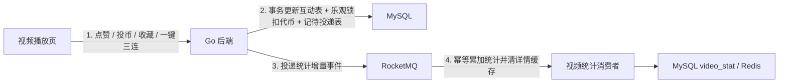
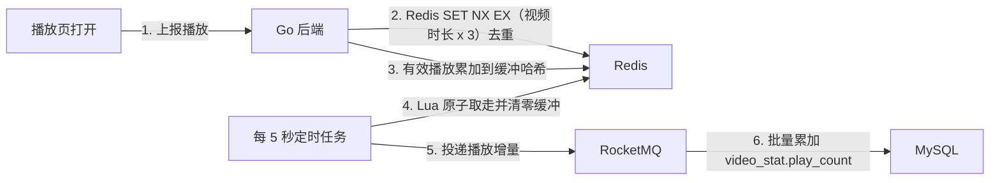
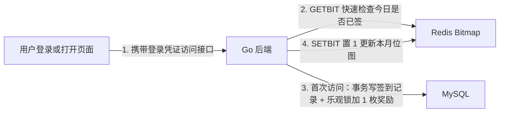

# 互动、播放计数削峰、观看历史与每日签到模块说明

## 点赞、投币、多收藏夹与一键三连

观众进入已发布视频的播放页后，前端先向后端请求一次当前用户对这个视频的互动状态，拿到是否点赞、已投币数、是否收藏、已加入的收藏夹清单、当前账户代币余额以及上次观看到第几分几秒，页面一次性点亮按钮并定位续播位置。

点赞和取消点赞都在 MySQL 事务里更新互动状态，并且同事务写入一条统计待投递记录，提交后通过 RocketMQ 通知视频统计消费者按事件 ID 幂等增减点赞数并清理视频详情缓存。

投币时前端带上投币枚数（1 枚或 2 枚）和一个唯一请求标识。后端在单个事务里先查投币流水表有没有相同请求标识，有的话直接返回上次结果，防止网络重试重复扣币；接着检查目标视频不属于自己投稿、且这个视频累计投币不超过 2 枚，再用乐观锁版本号扣减用户余额，并发冲突时自动重试，余额不足直接返回错误码并在页面弹出提醒。

收藏支持多收藏夹管理。用户第一次收藏或者打开收藏夹列表时，后端会自动建好一个默认收藏夹，用户可以随时新建公开或私密收藏夹、改名以及删除普通收藏夹。给视频勾选多个收藏夹保存时，后端在事务里同步增删收藏项和维护每个收藏夹的数量；只有当这个视频在用户所有收藏夹里的出现次数从 0 变成至少 1，或者从至少 1 减回 0 时，才给视频总收藏数加 1 或减 1。

在播放页长按点赞按钮 1.5 秒会触发蓄力动效并调用一键三连接口：没点过赞就补上点赞，已经赞过继续保持点赞；没收藏过就自动加进默认收藏夹，已经收藏继续保持收藏；需要补投币时如果代币充足并且目标视频属于其他作者就自动扣币，如果余额不足或者属于自己的视频则跳过投币，保留点赞和收藏结果，并在前端弹出明确提示。

## 播放量动态防刷与计数削峰

观众打开视频页时，前端上报一次播放。后端读取视频总时长，按视频时长的 3 倍计算防刷窗口（例如 30 分钟的视频对应 90 分钟有效播放窗口，极短视频保底 30 秒），用 Redis 针对同一用户或者同一客户端 IP 写入带过期时间的去重键。

窗口内重复刷新不会重复计数；通过去重后，后端先把加 1 写进 Redis 播放量缓冲哈希里，接口立刻返回。同进程的后台定时任务每隔 5 秒用 Lua 脚本原子取走缓冲里的全部增量，批量投递到 RocketMQ，由视频统计消费者统一累加到 MySQL 的视频统计表并刷新详情缓存。

## 观看历史缓冲与断点续播

登录用户看视频时，前端每 5 秒以及暂停、切换分 P、离开页面时都会把当前分 P 和秒数上报给后端。后端拿到后先立刻写进 Redis 的用户热进度缓存，这样哪怕用户一秒钟后立刻刷新页面，也能马上读到准确进度自动跳回刚才的位置。

同时后端把这条进度事件投递到 RocketMQ，后台拉模式消费者按批次把进度事件拉出来，在内存里按用户和视频折叠只保留最新一条，再用一条批量写入语句更新到 MySQL 观看历史表。在观看历史页面查询时，后端会把 Redis 里的最新热进度和 MySQL 历史记录合并排序，支持按视频标题搜索、单条删除和一键清空，删除或清空时同步记录清理标记防止队列里还没处理完的旧进度把删掉的历史重新写回来。

## 每日 Redis 位图自动签到

每日签到与哔哩哔哩保持一致，不需要用户手动点签到按钮，全部按东八区日期自动完成。每个用户每个月在 Redis 里对应一个位图键，当月第几天对应第几位，一整月只占 4 字节。

用户当天首次登录或者打开网页访问个人资料、签到状态等已登录接口时，后端先用 `GETBIT` 检查今天对应的比特位：已经签过直接跳过，几乎没有额外开销；如果今天还没签到，后端自动开启 MySQL 事务，向签到记录表插入当日记录（依靠用户加日期唯一索引防止并发多发），并用乐观锁给账户余额加 1 枚奖励；事务提交成功后再执行 `SETBIT` 把今天对应比特位置为 1。即使一直停留在页面跨过零点继续操作，鉴权中间件通过后的轻量位图检查也会自动完成新一天的签到。查询本月签到日历、累计天数和连续签到天数时，通过 `BITCOUNT` 和 `BITFIELD` 一次从 Redis 位图读出计算，若缓存键缺失则自动从 MySQL 当月签到记录回填。
