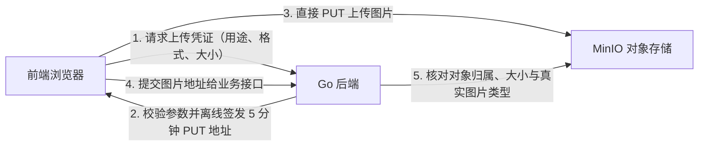
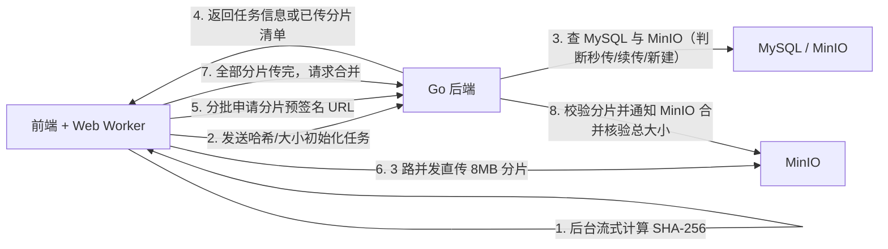

# 图片直传与视频分片上传模块说明

## 图片预签名直传

头像、视频封面、动态配图都走同一套图片直传流程，图片流量直接从浏览器传到 MinIO，不经过 Go 后端中转：

首先，前端告诉后端这张图片打算用在什么业务场景、是什么格式以及有多大。后端校验格式和大小（不超过 5 MB）合法后，按照业务目录和当前用户 ID 拼出对象路径，用 MinIO 的 S3 协议离线签发一个 5 分钟有效的临时上传 URL 返回给前端。

然后，前端拿到这个地址，直接通过 Nginx 反向代理把图片 PUT 到 MinIO。上传完成后，前端把图片访问路径连同业务表单（比如保存个人资料或者提交视频稿件）一起交给后端，由对应业务接口去 MinIO 核实文件确实存在、归属当前用户且文件头字节属于合法图片格式。

## 视频大文件分片直传、秒传与断点续传

首先，用户选好视频文件后，前端会在浏览器的 Web Worker 里分块计算这个视频的 SHA-256 文件哈希，避免大文件算哈希把页面卡住。

接着，前端带着文件哈希、字节大小、文件名和格式发一次初始化请求给后端。后端会按顺序处理三种情况：
- **命中秒传**：后端去 MySQL 查找是否已经有相同哈希和大小的已完成记录，并且再去 MinIO 确认对象还在且大小一致。如果都对得上，后端直接给当前用户新建一条已完成的上传任务并返回秒传成功，前端一个分片都不用传。
- **命中断点续传**：如果没命中秒传，但当前用户之前传这个文件传到一半停了，后端就去 MinIO 查询这次分片会话里已经传上去的分片列表，把已上传的分片编号和 ETag 返回给前端，前端只需要补传剩下的分片。
- **新建上传**：前两种情况都没命中时，后端调用 MinIO 创建一个新的分片上传会话，按每片 8 MB 算出分片总数，把任务记录写进 MySQL 并返回给前端。

然后，前端按缺失的分片编号分批向后端申请预签名上传地址，后端返回 15 分钟有效的 MinIO 上传链接。前端把视频切成 8 MB 的分片，开 3 路并发直接 PUT 到 MinIO，同时记下每片返回的 ETag。上传过程中用户可以随时暂停、继续或者取消；如果点击取消，后端会通知 MinIO 中止会话并清理碎片，把任务标为已取消。

所有分片都传完以后，前端发一个完成请求给后端。后端先在数据库事务里锁住这条任务记录防止重复合并，再去 MinIO 核对实际收到的分片总数、每片字节大小和 ETag。确认完全一致后，后端通知 MinIO 把所有分片合并成一个完整视频对象，再检查一次合并后的总字节数。如果总大小对不上，后端会删除这个异常对象并报错；确认无误后就把上传任务标为已完成，返回结果给前端供后续投稿使用。

如果用户传到一半直接关掉页面再也没有继续，MinIO 服务端配置了 24 小时过期清理策略，会自动定期回收这些超时未合并的碎片。
