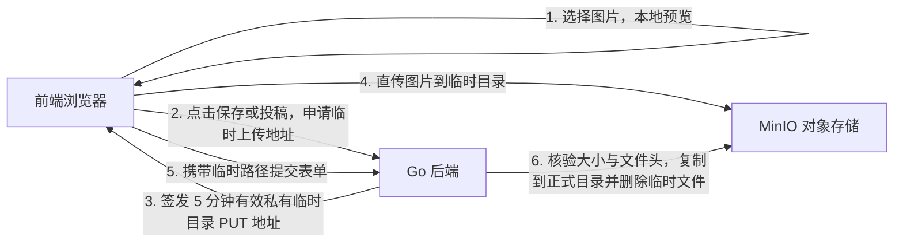
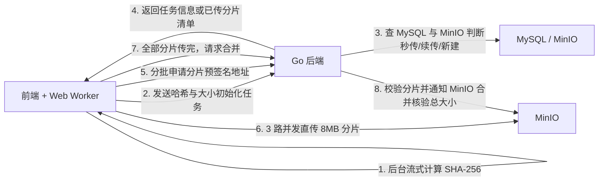

# 图片直传与视频分片上传模块说明

## 图片本地预览、临时上传与正式转正

头像和视频封面采用“先本地预览、提交表单时再直传临时目录、后端核验后转正”的流程，图片流量直接从浏览器传到对象存储，不经过后端中转：

用户选择本地头像或视频封面后，前端只校验格式和大小，并通过浏览器本地预览地址展示效果，不会立刻向服务器发起上传请求。如果用户反复更换图片或者直接退出页面，对象存储里不会留下任何多余文件。

当用户点击“保存”、“立即投稿”或“保存修改”时，前端先请求后端签发一张 5 分钟有效的预签名上传链接。后端把目标路径定在受保护的临时前缀下，这个临时前缀不允许匿名公开读取，防止未通过校验的文件被直接当成图床访问。

前端将图片直接 PUT 到临时目录后，再把临时路径连同表单内容提交给业务接口。后端业务接口在事务内核验对象确实存在、归属当前用户、大小不超过 5 MB 且文件头字节属于真实图片格式：
- 如果文件头格式不合法，后端会立即删除这个临时对象并拒绝保存；
- 如果校验通过，后端会通知 MinIO 在存储桶内部把文件复制到正式公开目录，再删除临时文件，并把正式地址写入数据库。如果随后数据库写入失败回滚，后端也会一并删除刚刚复制过去的正式文件。

此外，当用户成功更换为新的头像或视频封面后，后端会检查旧图片地址是否属于本站正式图片目录；确认没有其他账号或视频引用该旧图时，会顺带把旧文件从对象存储中删除。

## 视频大文件分片直传、秒传与断点续传

首先，用户选好视频文件后，前端会在浏览器的 Web Worker 里分块计算这个视频的 SHA-256 文件哈希，避免大文件算哈希把页面卡住，同时允许用户趁视频传输的时间同步填写标题、分区、标签和简介。

接着，前端带着文件哈希、字节大小、文件名和格式发一次初始化请求给后端。后端按顺序处理三种情况：
- **命中秒传**：后端去 MySQL 查找是否已经有相同哈希和大小的已完成记录，并且再去 MinIO 确认对象还在且大小一致。如果都对得上，后端直接给当前用户新建一条已完成的上传任务并返回秒传成功，前端一个分片都不用传。
- **命中断点续传**：如果没命中秒传，但当前用户之前传这个文件传到一半停了，后端就去 MinIO 查询这次分片会话里已经传上去的分片列表，把已上传的分片编号和 ETag 返回给前端，前端只需要补传剩下的分片。
- **新建上传**：前两种情况都没命中时，后端调用 MinIO 创建一个新的分片上传会话，按每片 8 MB 算出分片总数，把任务记录写进 MySQL 并返回给前端。

然后，前端按缺失的分片编号分批向后端申请预签名上传地址，后端返回 15 分钟有效的 MinIO 上传链接。前端把视频切成 8 MB 的分片，开 3 路并发直接 PUT 到 MinIO，同时记下每片返回的 ETag。上传过程中用户可以随时暂停、继续或者取消；如果点击取消，后端会通知 MinIO 中止会话并清理碎片，把任务标记为已取消。

所有分片都上传完成以后，前端发一个完成请求给后端。后端先在数据库事务里锁住这条任务记录防止重复合并，再去 MinIO 核对实际收到的分片总数、每片字节大小和 ETag。确认完全一致后，后端通知 MinIO 把所有分片合并成一个完整视频对象，再检查一次合并后的总字节数。如果总大小对不上，后端会删除这个异常对象并报错；确认无误后就把上传任务标记为已完成，页面提示视频文件已就绪并允许点击“立即投稿”。

## 残留文件与过期任务清理

为了避免用户中途关闭页面或放弃投稿造成存储空间浪费，系统设置了两层回收机制：

1. **MinIO 存储桶生命周期与服务端自动清理**
   存储桶在初始化时会配置临时图片目录满 1 天后自动过期的生命周期规则；同时 MinIO 服务端配置了 24 小时超时清理策略，自动回收超时未合并的分片碎片。

2. **后端定时分批巡检清理**
   Go 后端内置同进程定时清理任务（默认每小时巡检一次，清理超过 24 小时的过期任务）。多实例部署时通过 Redis 分布式锁确保同一时间只有一个实例执行巡检，并按主键游标每次取小批量记录分批处理：
   - 对超期仍停留在上传中的任务，尝试通知 MinIO 中止残留的分片会话并将任务标记为已过期；
   - 对超期已完成上传、但迟迟未点击投稿的任务，先用批量查询核对这些原始视频对象键是否已被视频分 P 记录引用，同时排除 24 小时内被其他用户通过秒传复用的对象；随后在数据库短事务内加行锁再次复核无引用后把任务标记为已过期，最后删除 MinIO 中的原始视频文件。
