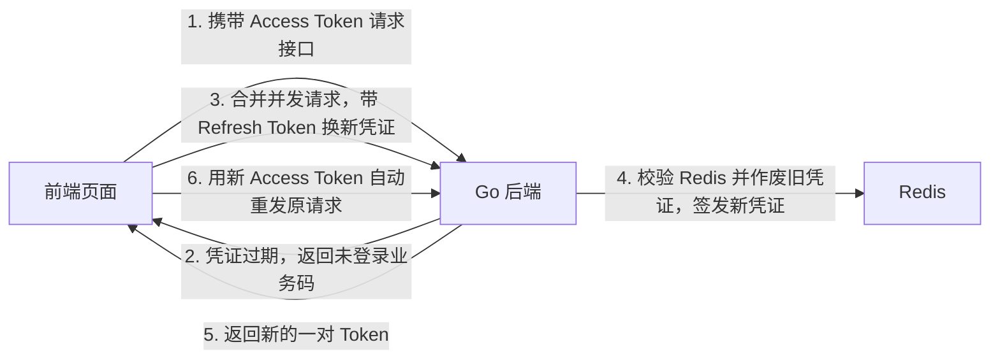

# 用户与认证模块说明

## 注册和登录

用户在网页上填写用户名、昵称和密码点击注册后，前端会把表单内容发给后端。后端在入口处先做一次基础检查，确认字段不为空并且长度合法，接着用 SHA-256 预处理密码，再用 bcrypt 加盐加密，保证 MySQL 里只保存加密后的哈希值。写入新用户数据时，系统会自动送 10 枚初始代币并配上默认头像。

注册或者登录成功后，后端会通过 JWT 签发一对凭证返回给前端：
- **Access Token**：有效期 15 分钟，平时访问需要登录的接口都带在请求头里。
- **Refresh Token**：有效期 7 天，后端同时会把它记录到 Redis 中，方便后续校验和主动注销。

## 凭证自动续期和退出登录

平时页面发请求时，如果刚好碰到 Access Token 过期，后端会统一返回 HTTP 200 和未登录业务码。前端拦截到这个状态后，会拿本地保存的 Refresh Token 自动请求刷新接口。如果同一瞬间页面发了好几个请求都过期了，前端会把它们合并成一次刷新操作，等拿到新的双 Token 后，再把刚才失败的请求全部自动重发一遍，用户完全感受不到掉线。

后端处理刷新请求时，会去 Redis 核对这条 Refresh Token 是否有效。验证通过后签发一对全新凭证，并立刻把旧的 Refresh Token 从 Redis 中删除，防止旧凭证被重复利用。用户主动点击退出登录或者修改密码时，后端同样会直接清除 Redis 中的 Refresh Token，让登录状态立即失效。

## 个人资料、头像更新和公开主页

用户在个人中心更换头像时，选好图片先在浏览器本地预览，不会立刻修改数据库。等用户改好昵称、简介点击保存时，前端会先通过预签名上传流程把新头像直传到 MinIO，拿到公开访问地址后，再连同其他资料一起提交给后端。

后端收到修改资料请求后，如果里面带有新头像地址，就会去 MinIO 亲自核验一遍：检查对象路径是不是在当前用户的头像目录下、文件存不存在、大小有没有超过 5 MB，再读取文件开头的字节判断真实图片类型。如果发现有人拿其他文件改后缀冒充图片，后端会直接删除 MinIO 里的假文件并返回参数错误；全部核验通过才会更新 MySQL 中的用户信息。

访问任意用户的个人空间主页时，前端带着用户 ID 来查询，后端只返回头像、昵称、简介、关注数、粉丝数和注册时间这些公开字段，密码哈希、手机号、邮箱等隐私数据不会对外暴露。
