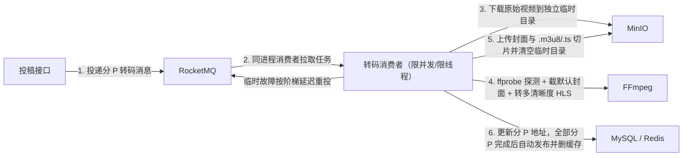

# 视频稿件、转码与播放模块说明

## 投稿提交与同文件秒级复用

用户在创作中心传完一个或者多个视频文件后，填写标题、分区、标签、简介和各个分 P 的标题，封面可以自己直传，也可以留空等转码时自动截取。点击提交投稿时，前端把稿件信息和每个分 P 对应的上传任务 ID 发给后端。

后端先核验每个上传任务是不是都属于当前用户且处于已完成状态；如果作者传了自定义封面，后端也会去 MinIO 校验封面归属、大小和真实图片类型。全部校验通过后，后端在 MySQL 事务里生成对外展示的唯一 BV 号，并创建稿件、分 P、统计和标签关联记录。

在这个过程中，后端会顺便检查数据库里有没有已经转码成功的历史分 P 用的是同一个原始视频对象（比如秒传或者重复投稿同一素材）。如果命中了，后端直接把现成的各清晰度 HLS 地址和视频时长复用过来，这个分 P 立刻标为转码完成；如果整个稿件里的全部分 P 都复用成功，稿件直接变成已发布状态，不需要再等转码。对于需要重新转码的分 P，后端把稿件标为转码中，等数据库事务提交完以后，把转码任务按分 P 投递到 RocketMQ。

## 同进程 FFmpeg 异步转码与自动重试

转码消费者和 Go 的 HTTP 接口运行在同一个进程里，共用数据库连接池和退出信号。为了避免转码把 CPU 占满导致网页请求卡顿，消费者内部通过并发信号量控制同时运行的 FFmpeg 任务数量，并给 FFmpeg 命令显式指定线程数上限。

消费者收到 RocketMQ 推过来的转码任务后，先在数据库里条件抢占状态，把分 P 改成转码中，防止同一条消息重复处理。接着在配置好的转码工作目录下创建一个独立子目录，从 MinIO 下载原始视频文件。

下载完后，先用 `ffprobe` 读取视频的真实时长、分辨率高度以及是否包含音轨（无声音轨的视频也能正常转码）。如果作者没有手动上传封面，就用 FFmpeg 截取第 1 秒（视频时长不足或等于 1 秒就截第 0 秒）生成默认封面上传到 MinIO 并回写给稿件。

接着用 FFmpeg 生成多清晰度 HLS 播放列表（`.m3u8`）和切片文件（`.ts`），清晰度按原视频高度向下适配：原视频达到 1080P 输出 1080P、720P、480P 三档；达到 720P 输出 720P 和 480P 两档；低于 720P 只输出 480P，不强行向上拉伸画质。所有切片上传到 MinIO 之后，不管这次转码成功还是失败，本地临时子目录都会立刻删除干净。

随后后端把各清晰度播放地址和时长写回分 P 记录，并检查同一稿件下的所有分 P。当全部分 P 都转码完成时，汇总总时长更新到稿件表，把稿件状态自动改为已发布并删除 Redis 里的视频详情缓存。

如果中途遇到网络波动等可恢复错误，消费者会通过 RocketMQ 的延迟消息，按 10 秒、30 秒、2 分钟的阶梯间隔自动延迟重投，最多重试 3 次；如果遇到文件损坏、无有效视频流这类不可恢复问题，或者超过重试次数，就把分 P 和稿件标为转码失败，作者后续也可以在稿件管理里手动触发重新转码。

## 视频浏览、缓存防护、搜索与播放

打开首页或者分区页时，前端先请求后端拿到启动自动迁移初始化好的 15 个分区列表，再按分区和排序条件（最新、热门、最多播放、最多弹幕）分页拉取已发布视频。后端查询全程不做 SQL 连表，先把视频记录查出来，提取所有作者 ID 和分区 ID 后批量查出作者信息和统计数据，在内存中拼装返回。

访问视频详情页时，已发布视频优先读 Redis 缓存，并且缓存过期时间会加上随机抖动，避免大量缓存同一时刻失效。遇到热点视频缓存刚过期被高并发访问时，后端用 `singleflight` 把同一批并发请求合并成一次查库；遇到不存在的 BV 号也会在 Redis 记一小会儿空值，挡住恶意穿透请求。如果是作者本人带着登录凭证访问，还能查看自己正在转码中或者转码失败的稿件。

前端播放页使用 `hls.js` 加载 MinIO 托管的 HLS 视频流，支持根据当前分 P 可用档位切换 1080P、720P、480P 清晰度，切换时会记住当前播放时间点无缝续播，同时支持倍速、音量、全屏和多分 P 选集切换。

搜索框输入关键词后，后端先把通配符转义，再分别按标题模糊匹配已发布视频、按昵称和用户名模糊匹配正常用户，把搜到的 UP 主和视频列表一起返回，并支持分区筛选和排序切换。

在创作中心的稿件管理页面，如果列表里还有转码中的稿件，前端每 3 秒自动刷新一次状态直到变成已发布。作者可以在这里直接修改稿件标题、分区、标签、简介、封面和分 P 顺序，或者下架稿件，每次修改后后端都会主动清除 Redis 里的详情缓存。
