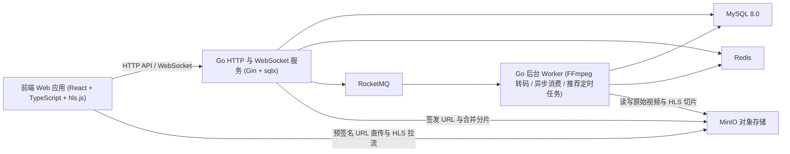

# simple_bilibili 业务需求与技术方案文档

## 1. 项目定位

`simple_bilibili` 是一个面向网页端的视频社区系统。前端界面与交互高度还原哔哩哔哩网页端，后端围绕 Go 服务端的高并发读写入、大文件分片传输与异步转码、实时长连接通信、多级缓存防护以及基础推荐算法进行完整设计。

## 2. 项目使用的技术与中间件

### 2.1 前端技术选型
- **核心框架**：React + TypeScript + Vite
- **视频流播放**：`hls.js`（播放多清晰度 `.m3u8` / `.ts` 视频流，支持清晰度切换、倍速播放与断点续播）
- **实时通信**：浏览器原生 WebSocket（视频房间实时弹幕收发、在线人数更新、站内未读通知推送）
- **弹幕渲染**：独立 Canvas 或高性能动画层叠加在播放器上方

### 2.2 后端技术选型
- **Web 框架**：Go + Gin（路由管理、统一鉴权中间件、限流中间件、TraceID 透传、错误码规范）
- **配置管理**：Viper（读取 YAML 格式配置文件，并支持环境变量覆盖）
- **数据访问**：`sqlx`（执行可控的原生 SQL 并自动映射 Go 结构体，配合 `sqlx.In` 执行批量 ID 查询与 `BeginTxx` 事务管理）
- **媒体处理**：FFmpeg（提取视频时长、分辨率、首帧封面，转码生成 1080P、720P、480P 多清晰度 HLS 流切片）

### 2.3 存储与中间件
- **MySQL 8.0**：业务核心数据持久化存储
- **Redis**：双 Token 状态管理、Lua 分布式限流器、视频播放与互动计数缓冲、排行榜、热点视频与评论缓存、用户已曝光去重集合、推荐算法画像与召回池
- **MinIO**：兼容 S3 协议的对象存储，用于大文件分片上传、预签名 URL 直传、封面图、用户头像与转码后的 HLS 切片托管
- **RocketMQ**：视频异步转码任务调度、互动计数异步回写、投币与稿件发布事务消息、转码失败延迟重试、站内消息通知、动态写扩散与推荐系统行为日志采集
- **Docker Compose**：一键编排 MySQL、Redis、MinIO、RocketMQ 及前后端应用服务

### 2.4 系统整体架构

## 3. 前端界面与交互范围（哔哩哔哩网页端还原）

- **首页**：顶部导航栏（入口链接、搜索框、消息红点、动态入口、历史记录、投稿按钮、登录与用户头像弹窗）、顶部横幅、分区频道导航栏、左侧轮播图与右侧推荐视频卡片网格、“换一换”刷新按钮、下拉无限加载、全站与分区排行榜入口。
- **视频播放页**：视频播放器（多清晰度切换、倍速、音量、全屏、进度记忆）、弹幕滚动展示层与底部弹幕发送栏（字号、颜色、位置选择）、实时在线观看人数显示、视频分 P 选集列表、视频简介与标签、点赞/投币（1 枚或 2 枚弹窗）/收藏（多收藏夹弹窗）/转发及长按一键三连动效、UP 主信息卡片与关注按钮、两级楼中楼评论区、右侧“相关推荐”视频列表。
- **搜索结果页**：展示按关键词检索出的视频列表与 UP 主列表，提供分区筛选与排序切换（综合排序、最多播放、最新发布、最多弹幕）。
- **创作中心与投稿页**：拖拽上传视频、上传进度条与暂停/断点续传、封面截取与自定义上传、标题/分区/标签/简介编辑、分 P 排序管理、稿件列表与转码进度状态展示。
- **个人空间、动态流与消息中心**：UP 主与个人主页（投稿视频、公开/私密收藏夹、观看历史、关注与粉丝列表）、关注动态时间线页面、消息中心（回复我的、收到的赞、新增关注、系统通知及未读数清理）。

## 4. 后端业务需求详细说明

### 4.1 账号认证与接口限流
- 支持邮箱或手机号注册、密码登录、登出、个人资料修改与头像上传。
- 密码采用 `bcrypt` 加盐哈希存储。
- 认证机制使用双 Token（短期 Access Token 与长期 Refresh Token），Refresh Token 存入 Redis 以支持无感续期与主动踢出。
- 基于 Redis + Lua 脚本实现令牌桶与滑动窗口限流中间件，覆盖登录防爆破、发送弹幕、发表评论、投稿上传与高频互动接口。

### 4.2 视频投稿、分片直传与异步转码流水线
- **秒传与断点续传**：前端计算视频文件哈希，初始化上传任务时后端校验是否已存在相同哈希文件（命中则直接完成秒传）；未命中时按固定分片大小切分，记录每个分片上传状态以支持断点续传。
- **MinIO 预签名直传**：后端为每个分片签发有时效限制的预签名上传 URL，前端直传 MinIO；全部分片上传完成后通知后端触发分片合并与完整性校验。
- **异步转码流水线**：合并完成后后端通过 RocketMQ 投递转码任务，Worker 消费任务调用 FFmpeg 获取视频元数据、抽取默认封面，并转码输出 1080P、720P、480P 的 HLS（`.m3u8` + `.ts`）切片上传至 MinIO。
- **状态流转与重试**：稿件任务经过“上传中 -> 转码中 -> 待审核/已发布 -> 转码失败”状态流转；转码失败时借助 RocketMQ 延迟消息执行阶梯重试，超过重试上限后标记异常状态并通知作者。

### 4.3 视频播放、实时弹幕与在线人数
- **流式播放与续播**：按视频 ID 与分 P ID 返回各清晰度 `.m3u8` 播放地址及上次观看进度秒数，前端定时上报最新播放位置。
- **WebSocket 弹幕广播**：按视频房间维护 WebSocket 连接池，包含客户端心跳检测与断开连接自动清理；用户发送弹幕时先执行用户级频率限流，随后实时广播给当前视频房间内的全部在线观众，并投递 RocketMQ 由拉模式消费者批量持久化入库与异步累加视频弹幕计数。
- **历史弹幕分段加载**：历史弹幕按视频 ID 与时间窗口分段缓存在 Redis 中，播放过程中分段拉取以降低单次传输体积。
- **实时在线人数**：依据视频房间活跃 WebSocket 连接数与心跳记录统计并定期广播当前观看人数。

### 4.4 高并发互动、计数削峰与观看历史
- **点赞、投币、收藏与转发**：
  - 投币涉及用户代币余额扣减与单视频上限校验（最多投 2 枚），通过数据库事务、乐观锁版本号与唯一约束防止并发超扣与重复记账，并结合 RocketMQ 事务消息保证扣款记录与后续互动统计同步的一致性。
  - 收藏支持用户创建多个收藏夹、编辑收藏夹公开或私密属性、将同一视频加入多个收藏夹。
- **一键三连编排**：提供聚合接口在单次请求内依次完成点赞、投币与加入默认收藏夹，对用户已提前完成的部分动作保持幂等。
- **互动与播放计数削峰**：播放量、点赞数、投币数、收藏数与弹幕数高频变动先累加到 Redis 计数器（播放量按用户 ID 或客户端 IP 在设定时间窗口内去重防刷），再通过定时任务或 RocketMQ 消费者批量合并回写至 MySQL `video_stat` 表。
- **观看历史缓冲**：播放进度上报先写入 Redis，后台异步批量持久化到 MySQL，支持按时间分页查看、关键词过滤与一键清空。

### 4.5 两级楼中楼评论区
- 评论采用两级结构（根评论与其下全部子回复列表），支持回复根评论或回复指定子评论用户。
- 支持按“最热”和“最新”切换排序；热评权重综合点赞数、回复数与发布时间衰减计算，并对热门视频前几页评论列表建立 Redis 缓存。
- 支持游标分页、UP 主置顶评论、“UP 主觉得很赞”标识、评论点赞/点踩与作者删评。
- 评论写入后通过 RocketMQ 异步累加视频总评论数并生成站内回复通知。

### 4.6 首页推荐、排行榜与基础推荐算法
- **全站与分区排行榜**：使用 Redis Sorted Set（ZSet）维护全站日榜、周榜及各分区榜单，按时间衰减热度公式定时更新。
- **用户行为采集与画像更新**：
  - 前端在有效播放（播放进度达到 30% 及以上）、点赞、投币、收藏、转发或点击“不感兴趣”时调用接口上报，Gin 服务将行为事件投递到 RocketMQ `user_behavior_topic`。
  - Go 消费者订阅消息，写入 MySQL `user_video_behavior` 表，并通过 `ZINCRBY` 实时累加 Redis 中该用户的标签兴趣画像（`rec:user:tag:{user_id}`），同时维护用户近期正向交互视频集合（`rec:user:recent:{user_id}`）与不感兴趣视频集合（`rec:user:dislike:{user_id}`）。
- **定时离线计算任务**：
  - **热度池计算（每 10 分钟执行）**：按下列公式计算活跃视频热度分值并刷新全站热门池（`rec:global:hot`）与标签热门池（`rec:tag:hot:{tag_id}`），其中 $T_{\text{hours}}$ 为视频发布至今的小时数：
    $$\text{HotScore} = \frac{\text{play} \times 1 + \text{danmaku} \times 2 + \text{like} \times 4 + \text{favorite} \times 6 + \text{coin} \times 8}{(T_{\text{hours}} + 2)^{1.5}}$$
  - **ItemCF 物品协同过滤计算（每小时或每日低峰期执行）**：读取近 30 天正向行为记录，按用户分组统计视频交互人数 $|N(i)|$ 与共现关系，引入活跃用户惩罚因子 $\frac{1}{\log(1 + |N(u)|)}$ 计算视频 $i$ 与视频 $j$ 的余弦相似度：
    $$W_{ij} = \frac{\sum_{u \in N(i) \cap N(j)} \frac{1}{\log(1 + |N(u)|)}}{\sqrt{|N(i)| \cdot |N(j)|}}$$
    为每个视频截取相似度最高的 Top-30 写入 Redis（`rec:itemcf:{video_id}`）。
- **在线推荐召回与重排链路**：
  - **首页推荐流与“换一换”**：每次请求按配额执行三路召回（ItemCF 相似召回 40%、用户高分兴趣标签热门池召回 30%、全站热门池与新稿件池召回 30%，冷启动用户由热度与新稿件池补齐全部配额），剔除已曝光集合（`rec:user:seen:{user_id}`）与不感兴趣集合中的视频，加权融合排序并执行多样性打散（单页同一 UP 主最多出现 1 条、同一分区最多连续出现 2 条），输出前将本次曝光的视频 ID 写入已曝光集合以保证“换一换”无重复。
  - **播放页右侧“相关推荐”**：直接读取 `rec:itemcf:{video_id}` 的 Top-N 视频，冷启动新视频由同标签热门池与全站热门池补足，并排除当前播放视频本身。

### 4.7 基础关键词搜索
- 对视频表标题字段与用户表昵称字段执行 `sqlx` `LIKE '%keyword%'` 基础关键词匹配。
- 支持按分区筛选，以及按综合（热度分）、最多播放、最新发布、最多弹幕排序分页展示。

### 4.8 关注关系、动态 Feed 流与消息中心
- **关注与粉丝关系**：支持关注、取消关注、互关状态判定，使用 Redis Set 缓存关注集合以加速校验，关注列表与粉丝列表支持分页查询。
- **混合模式动态 Feed 流**：支持 UP 主发布新视频自动生成投稿动态，以及手动发布图文动态。普通 UP 主发布动态时通过 RocketMQ 异步写扩散至粉丝收件箱；粉丝量超过设定阈值的高粉丝 UP 主采用读扩散，粉丝访问动态页时实时拉取并与收件箱数据按时间游标归并排序。
- **消息中心**：点赞、评论回复、新增粉丝、稿件转码与审核状态变更均经 RocketMQ 异步生成站内消息；Redis 维护各类别未读数，在线用户通过 WebSocket 实时收到未读红点更新。

## 5. 数据库设计规范与核心表结构

### 5.1 数据访问规范
- 全库所有数据表均采用逻辑外键，严禁建立物理外键约束。
- 所有关联查询均分步执行：先查询主表获取目标 ID 列表，再通过 `sqlx.In` 执行 `WHERE id IN (...)` 批量查询关联表，并在 Go 服务层内存中组装最终数据结构，严禁执行 SQL 连表查询。

### 5.2 核心业务表及字段说明

#### 1. `user`（用户表）
| 字段名 | 类型 | 业务说明 |
| :--- | :--- | :--- |
| `id` | `BIGINT` | 主键 ID |
| `username` | `VARCHAR(64)` | 登录账号名（唯一） |
| `nickname` | `VARCHAR(64)` | 用户展示昵称 |
| `email` | `VARCHAR(128)` | 绑定邮箱（唯一） |
| `phone` | `VARCHAR(32)` | 绑定手机号（唯一） |
| `password_hash` | `VARCHAR(255)` | `bcrypt` 加密后的密码哈希 |
| `avatar_url` | `VARCHAR(512)` | 头像在 MinIO 中的访问地址 |
| `bio` | `VARCHAR(255)` | 个人签名简介 |
| `coin_balance` | `INT` | 用户可用代币余额 |
| `follower_count` | `INT` | 粉丝总数 |
| `following_count` | `INT` | 关注总数 |
| `version` | `INT` | 乐观锁版本号（用于代币余额并发扣减） |
| `status` | `TINYINT` | 账号状态（1 正常，2 封禁） |
| `created_at` | `DATETIME` | 注册时间 |
| `updated_at` | `DATETIME` | 更新时间 |

#### 2. `video`（视频稿件主表）
| 字段名 | 类型 | 业务说明 |
| :--- | :--- | :--- |
| `id` | `BIGINT` | 主键 ID |
| `bv_id` | `VARCHAR(32)` | 对外展示的视频唯一编码 |
| `author_id` | `BIGINT` | 作者用户 ID（逻辑外键关联 `user.id`） |
| `category_id` | `INT` | 所属分区 ID（逻辑外键关联分区表） |
| `title` | `VARCHAR(128)` | 视频标题 |
| `description` | `TEXT` | 视频简介 |
| `cover_url` | `VARCHAR(512)` | 视频封面图地址 |
| `duration_sec` | `INT` | 视频总时长（秒） |
| `status` | `TINYINT` | 稿件状态（0 草稿，1 转码中，2 审核中，3 已发布，4 转码失败，5 已下架） |
| `published_at` | `DATETIME` | 正式发布时间 |
| `created_at` | `DATETIME` | 创建时间 |
| `updated_at` | `DATETIME` | 更新时间 |

#### 3. `video_part`（视频分 P 选集表）
| 字段名 | 类型 | 业务说明 |
| :--- | :--- | :--- |
| `id` | `BIGINT` | 主键 ID |
| `video_id` | `BIGINT` | 所属视频 ID（逻辑外键关联 `video.id`） |
| `part_index` | `INT` | 分 P 序号（从 1 开始） |
| `title` | `VARCHAR(128)` | 分 P 标题 |
| `duration_sec` | `INT` | 当前分 P 时长（秒） |
| `raw_object_key` | `VARCHAR(512)` | 原始视频在 MinIO 中的对象键 |
| `hls_1080p_url` | `VARCHAR(512)` | 1080P 清晰度 `.m3u8` 地址 |
| `hls_720p_url` | `VARCHAR(512)` | 720P 清晰度 `.m3u8` 地址 |
| `hls_480p_url` | `VARCHAR(512)` | 480P 清晰度 `.m3u8` 地址 |
| `transcode_status` | `TINYINT` | 转码状态（0 待转码，1 转码中，2 成功，3 失败） |
| `created_at` | `DATETIME` | 创建时间 |

#### 4. `video_stat`（视频互动统计表）
| 字段名 | 类型 | 业务说明 |
| :--- | :--- | :--- |
| `video_id` | `BIGINT` | 主键，对应 `video.id`（逻辑外键） |
| `play_count` | `BIGINT` | 累计播放量 |
| `danmaku_count` | `BIGINT` | 累计弹幕数 |
| `like_count` | `BIGINT` | 累计点赞数 |
| `coin_count` | `BIGINT` | 累计投币数 |
| `favorite_count` | `BIGINT` | 累计收藏数 |
| `share_count` | `BIGINT` | 累计转发数 |
| `comment_count` | `BIGINT` | 累计评论数 |
| `hot_score` | `DOUBLE` | 最近一次计算的热度分值 |
| `updated_at` | `DATETIME` | 最近同步时间 |

#### 5. `upload_task`（分片上传任务表）
| 字段名 | 类型 | 业务说明 |
| :--- | :--- | :--- |
| `id` | `BIGINT` | 主键 ID |
| `upload_id` | `VARCHAR(128)` | MinIO Multipart Upload ID |
| `user_id` | `BIGINT` | 上传者用户 ID（逻辑外键关联 `user.id`） |
| `file_hash` | `VARCHAR(64)` | 文件 SHA-256 哈希（用于秒传校验） |
| `file_name` | `VARCHAR(255)` | 原始文件名 |
| `file_size` | `BIGINT` | 文件总字节大小 |
| `chunk_size` | `INT` | 单个分片字节大小 |
| `total_chunks` | `INT` | 分片总数 |
| `object_key` | `VARCHAR(512)` | MinIO 目标对象键 |
| `status` | `TINYINT` | 上传状态（0 上传中，1 已合并完成，2 已取消/过期） |
| `created_at` | `DATETIME` | 创建时间 |
| `updated_at` | `DATETIME` | 更新时间 |

#### 6. `tag`（标签表）与 `video_tag`（视频标签关系表）
- `tag` 表：
  - `id`（`BIGINT`）：标签主键 ID
  - `name`（`VARCHAR(64)`）：标签名称（唯一）
  - `created_at`（`DATETIME`）：创建时间
- `video_tag` 表：
  - `id`（`BIGINT`）：主键 ID
  - `video_id`（`BIGINT`）：视频 ID（逻辑外键关联 `video.id`）
  - `tag_id`（`BIGINT`）：标签 ID（逻辑外键关联 `tag.id`）
  - `created_at`（`DATETIME`）：创建时间

#### 7. `danmaku`（弹幕表）
| 字段名 | 类型 | 业务说明 |
| :--- | :--- | :--- |
| `id` | `BIGINT` | 主键 ID |
| `video_id` | `BIGINT` | 视频 ID（逻辑外键关联 `video.id`） |
| `part_id` | `BIGINT` | 分 P ID（逻辑外键关联 `video_part.id`） |
| `user_id` | `BIGINT` | 发送者用户 ID（逻辑外键关联 `user.id`） |
| `content` | `VARCHAR(255)` | 弹幕文本内容 |
| `time_offset_ms` | `INT` | 弹幕在视频播放轴上的出现时间（毫秒） |
| `mode` | `TINYINT` | 显示模式（1 滚动，2 顶部固定，3 底部固定） |
| `font_size` | `TINYINT` | 字体大小 |
| `color` | `VARCHAR(16)` | 十六进制颜色值（如 `#FFFFFF`） |
| `created_at` | `DATETIME` | 发送时间 |

#### 8. `comment`（楼中楼评论表）
| 字段名 | 类型 | 业务说明 |
| :--- | :--- | :--- |
| `id` | `BIGINT` | 主键 ID |
| `video_id` | `BIGINT` | 视频 ID（逻辑外键关联 `video.id`） |
| `user_id` | `BIGINT` | 评论作者 ID（逻辑外键关联 `user.id`） |
| `root_id` | `BIGINT` | 根评论 ID（0 表示本身为根评论） |
| `parent_id` | `BIGINT` | 直接回复的父评论 ID（0 表示无父评论） |
| `reply_to_user_id` | `BIGINT` | 被回复用户 ID（逻辑外键关联 `user.id`） |
| `content` | `TEXT` | 评论正文 |
| `like_count` | `INT` | 评论点赞数 |
| `reply_count` | `INT` | 根评论下累计子回复数 |
| `is_pinned` | `TINYINT` | 是否被 UP 主置顶（0 否，1 是） |
| `is_up_liked` | `TINYINT` | 是否有“UP 主觉得很赞”标识（0 否，1 是） |
| `status` | `TINYINT` | 状态（1 正常，2 已删除） |
| `created_at` | `DATETIME` | 发表时间 |

#### 9. `video_interaction`（视频点赞与投币记录表）
| 字段名 | 类型 | 业务说明 |
| :--- | :--- | :--- |
| `id` | `BIGINT` | 主键 ID |
| `user_id` | `BIGINT` | 操作用户 ID（逻辑外键关联 `user.id`） |
| `video_id` | `BIGINT` | 目标视频 ID（逻辑外键关联 `video.id`） |
| `liked` | `TINYINT` | 是否点赞（0 否，1 是） |
| `coin_count` | `TINYINT` | 已投币数量（0、1 或 2） |
| `created_at` | `DATETIME` | 创建时间 |
| `updated_at` | `DATETIME` | 更新时间 |

#### 10. `favorite_folder`（收藏夹表）与 `favorite_item`（收藏夹明细表）
- `favorite_folder` 表：
  - `id`（`BIGINT`）：收藏夹主键 ID
  - `user_id`（`BIGINT`）：所属用户 ID（逻辑外键关联 `user.id`）
  - `title`（`VARCHAR(64)`）：收藏夹名称
  - `is_default`（`TINYINT`）：是否为默认收藏夹（0 否，1 是）
  - `is_public`（`TINYINT`）：是否公开可见（0 私密，1 公开）
  - `item_count`（`INT`）：收藏视频数量
  - `created_at`（`DATETIME`）：创建时间
- `favorite_item` 表：
  - `id`（`BIGINT`）：主键 ID
  - `folder_id`（`BIGINT`）：收藏夹 ID（逻辑外键关联 `favorite_folder.id`）
  - `user_id`（`BIGINT`）：用户 ID（逻辑外键关联 `user.id`）
  - `video_id`（`BIGINT`）：视频 ID（逻辑外键关联 `video.id`）
  - `created_at`（`DATETIME`）：收藏时间

#### 11. `watch_history`（观看历史表）
| 字段名 | 类型 | 业务说明 |
| :--- | :--- | :--- |
| `id` | `BIGINT` | 主键 ID |
| `user_id` | `BIGINT` | 用户 ID（逻辑外键关联 `user.id`） |
| `video_id` | `BIGINT` | 视频 ID（逻辑外键关联 `video.id`） |
| `part_id` | `BIGINT` | 最后观看的分 P ID（逻辑外键关联 `video_part.id`） |
| `progress_sec` | `INT` | 最后观看进度（秒） |
| `watched_at` | `DATETIME` | 最后观看时间 |

#### 12. `user_follow`（关注关系表）
| 字段名 | 类型 | 业务说明 |
| :--- | :--- | :--- |
| `id` | `BIGINT` | 主键 ID |
| `follower_id` | `BIGINT` | 关注发起者用户 ID（逻辑外键关联 `user.id`） |
| `followee_id` | `BIGINT` | 被关注的 UP 主 ID（逻辑外键关联 `user.id`） |
| `created_at` | `DATETIME` | 关注时间 |

#### 13. `dynamic_post`（动态内容表）
| 字段名 | 类型 | 业务说明 |
| :--- | :--- | :--- |
| `id` | `BIGINT` | 主键 ID |
| `user_id` | `BIGINT` | 发布者用户 ID（逻辑外键关联 `user.id`） |
| `dynamic_type` | `TINYINT` | 动态类型（1 视频投稿动态，2 图文动态） |
| `video_id` | `BIGINT` | 关联视频 ID（投稿动态时有效，逻辑外键关联 `video.id`） |
| `content` | `TEXT` | 动态文案 |
| `image_urls` | `JSON` | 配图 URL 列表 |
| `created_at` | `DATETIME` | 发布时间 |

#### 14. `notification`（站内消息通知表）
| 字段名 | 类型 | 业务说明 |
| :--- | :--- | :--- |
| `id` | `BIGINT` | 主键 ID |
| `receiver_id` | `BIGINT` | 接收通知的用户 ID（逻辑外键关联 `user.id`） |
| `sender_id` | `BIGINT` | 触发通知的用户 ID（0 表示系统通知，逻辑外键关联 `user.id`） |
| `notify_type` | `TINYINT` | 通知分类（1 评论回复，2 收到点赞，3 新增粉丝，4 系统通知） |
| `target_id` | `BIGINT` | 关联业务对象 ID（视频 ID 或评论 ID） |
| `content` | `VARCHAR(255)` | 通知摘要内容 |
| `is_read` | `TINYINT` | 是否已读（0 未读，1 已读） |
| `created_at` | `DATETIME` | 通知时间 |

#### 15. `user_video_behavior`（推荐算法用户行为表）
| 字段名 | 类型 | 业务说明 |
| :--- | :--- | :--- |
| `id` | `BIGINT` | 主键 ID |
| `user_id` | `BIGINT` | 触发行为的用户 ID（逻辑外键关联 `user.id`） |
| `video_id` | `BIGINT` | 目标视频 ID（逻辑外键关联 `video.id`） |
| `behavior_type` | `TINYINT` | 行为类型（1 有效播放，2 点赞，3 收藏，4 投币，5 转发，6 不感兴趣） |
| `weight` | `INT` | 行为权重分值（播放 +1、点赞 +3、收藏 +4、投币 +5、转发 +4、不感兴趣 -5） |
| `created_at` | `DATETIME` | 行为发生时间 |

## 6. 缓存防护与工程稳定性设计

- **多级缓存防护**：对首页推荐元数据、热门视频详情与热评列表采用 Redis 缓存，配合 Go `singleflight` 合并并发回源请求防止缓存击穿，接入布隆过滤器拦截无效视频 ID 防止缓存穿透，缓存 TTL 附加随机抖动区间防止缓存雪崩。
- **RocketMQ 部署与通信约定**：在 Docker Compose 编排中明确 RocketMQ 版本与宿主机可访问的 `brokerIP1`，通过 `JAVA_OPT` 限制 NameServer（256MB）与 Broker（512MB 至 1GB）的 JVM 堆内存上限。
- **可观测性与优雅停机**：HTTP 请求入口生成并向数据库日志、RocketMQ 消息头与 Worker 透传 `TraceID`；暴露 Prometheus 指标（请求 QPS、P95/P99 耗时、WebSocket 活跃连接数、转码队列消费耗时）；服务端监听终止信号，停止接入新流量并等待进行中的 HTTP 请求、WebSocket 连接清理及消息队列消费者安全退出。
